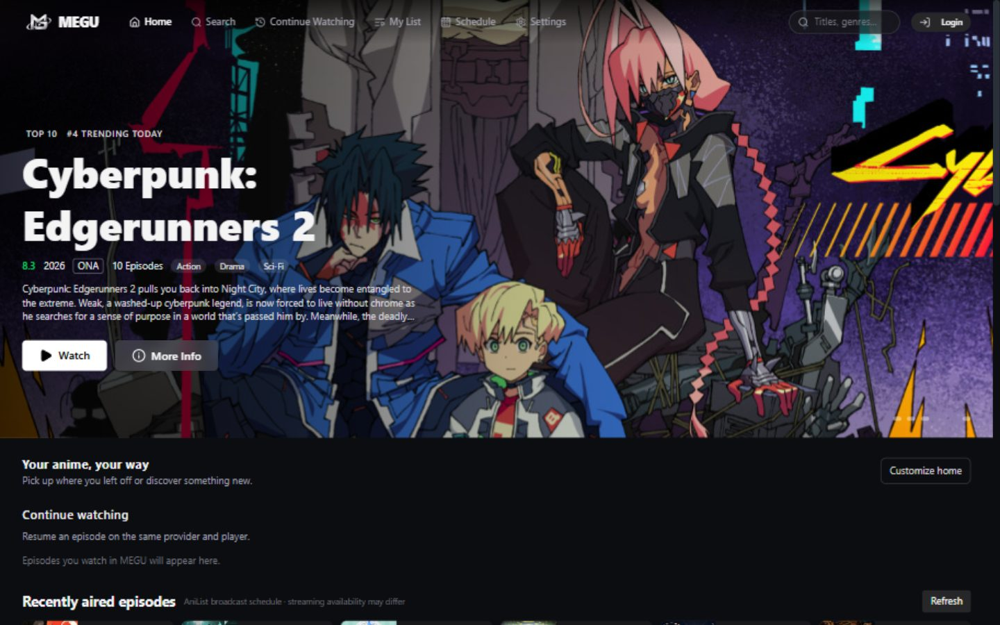
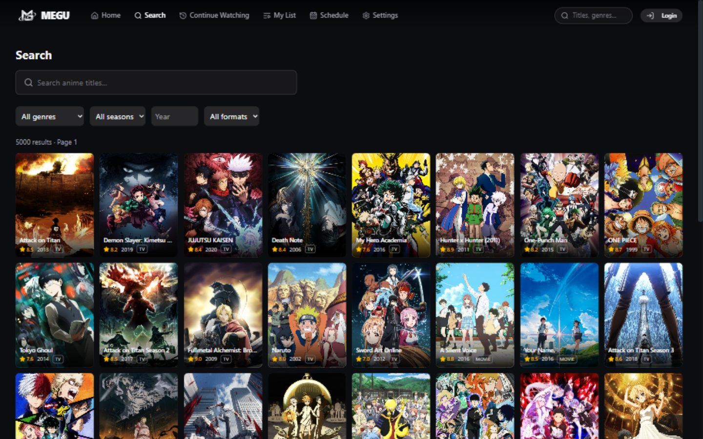
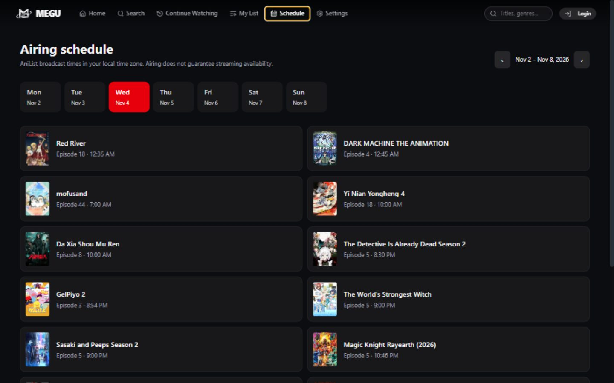
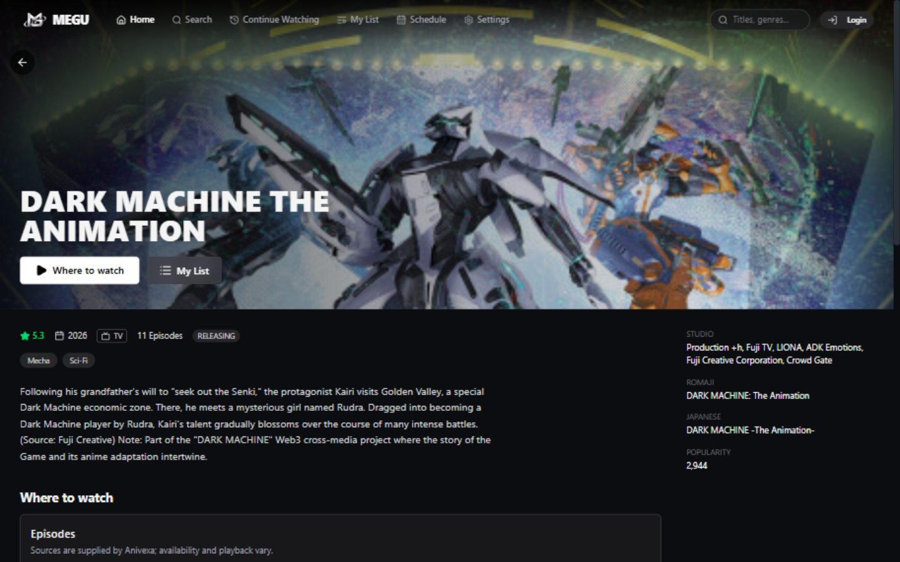
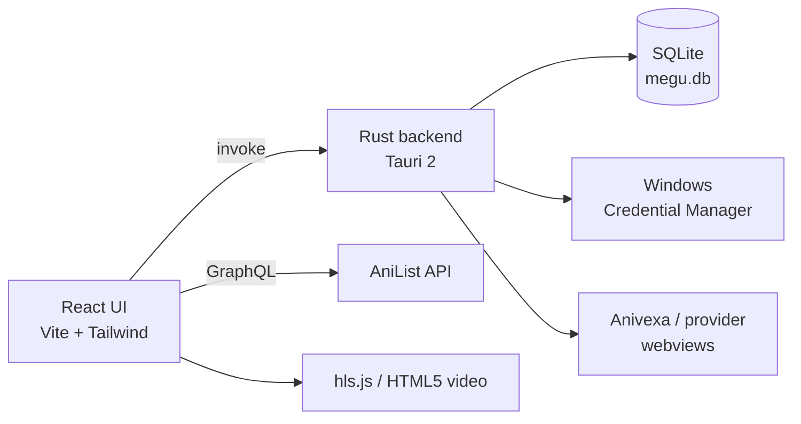

<div align="center">


# MEGU

**Anime, without the clutter.**

A Windows app for discovering anime on AniList, keeping your list in sync, and picking up where
you left off. It is built with Tauri and installs at about 16 MB.

[](#requirements)
[](https://tauri.app)
[](LICENSE)
[](#project-status)
[](https://github.com/RimunAce/megu/releases/latest)
[](https://github.com/RimunAce/megu/actions/workflows/ci.yml)

[**Download**](https://github.com/RimunAce/megu/releases/latest) · [Features](#features) · [Build from source](#build-from-source) · [Contributing](CONTRIBUTING.md) · [Privacy](#privacy-and-your-data)

</div>



---

## Why MEGU?

Most anime apps are a browser wrapped around a streaming page. MEGU is the opposite: a small,
purpose-built desktop app that treats your AniList account as the source of truth and gets out of
the way while you watch.

- **Built with Tauri and Rust** instead of Electron, so the installed app takes about 16 MB and runs
  in one window.
- **Works offline where it can.** Your list snapshot, queued edits and cached artwork stay available
  without a network.
- **Keeps offline edits visible.** Progress changes are queued, retried, and listed for review when
  AniList has moved on.
- **Separates schedules from streams.** Broadcast times come from AniList. They are not a promise
  that a stream exists, and the app labels them that way.

## Features

| | |
|:--|:--|
| **AniList browsing** | Trending, top rated, seasonal and popular rows, full-text search with genre, season, year and format filters, and rich detail pages. |
| **Two-way list sync** | Status, episodes, score, rewatches, notes, private entries, custom lists, start/finish dates, advanced scoring and favourites, all in *your* AniList score format. |
| **Offline-first list** | An account-specific snapshot is kept locally. Offline progress edits are queued and retried automatically. |
| **Sync review center** | A visible diff of what is queued, what AniList currently says, and a deliberate choice between the two. A conflicting AniList change stays queued until you choose. |
| **Continue watching** | Playback position is remembered per account, provider, player and episode, with a themed resume prompt. |
| **Airing schedule** | Week view with per-day breakdowns, local broadcast times, and a note that airing does not equal streaming. |
| **Airing reminders** | Optional Windows notifications for titles on your list, with a countdown on each list card. |
| **Provider diagnostics** | Plain-language explanations for missing episodes, unavailable players, verification walls and unsupported progress tracking. |
| **Offline artwork** | List covers and opened banners are cached from AniList's CDN under a strict size budget. |
| **Player support** | Direct HLS via hls.js, embedded players in a sandboxed child webview, and visible HTML5 video inside nested frames. |

<p align="center">
  
  
</p>



## Installation

### Just want to use it?

1. Open the [latest release](https://github.com/RimunAce/megu/releases/latest).
2. Download the Windows installer, e.g. `MEGU_0.1.0_x64-setup.exe`.
3. Run it. The final installer page offers **Create desktop shortcut** (ticked by default);
   MEGU is always added to the Start menu, so Windows Search finds it as **MEGU**. On first launch
   Windows SmartScreen may warn about an unsigned app. Choose **More info → Run anyway**, or verify
   the checksum published with the release.

> If Windows Search shows `megu.exe` from a folder such as `release` or
> `src-tauri\target\release`, that is a loose build output, not the installed app. Remove it and
> install with the setup file; the Start menu entry is simply **MEGU**.

> **Unsigned build:** MEGU is not code-signed yet, so SmartScreen and some antivirus products may
> flag it. Builds are produced from this repository by `npm run tauri build`.

### Requirements

| | |
|:--|:--|
| OS | Windows 10 (1809+) or Windows 11, 64-bit |
| Runtime | WebView2 (included with Windows 11 and current Windows 10) |
| Network | Required for first sign-in and streaming |
| Disk | About 16 MB for the app; caches grow with use |

`MSI` and `NSIS` installers are both produced by the build; the `-setup.exe` (NSIS) one is the
simplest choice.

## Connecting AniList

MEGU uses AniList's official OAuth flow. You create a small AniList API application once:

1. Go to <https://anilist.co/settings/developer> and choose **Create New Client**.
2. Set the redirect URL to exactly:

   ```text
   http://127.0.0.1:9420/callback
   ```

3. Copy the **Client ID** (and **Client Secret**, if AniList shows one) into MEGU's login dialog.
4. Approve access in the browser that opens. MEGU listens on the loopback redirect only.

The access token is stored in Windows Credential Manager, not in a plain-text file. Signing
out deletes it. Some features (My List, progress sync, reminders) require an account; browsing and
the schedule do not.

## How it works



| Layer | Notes |
|:--|:--|
| Frontend | React 19, TypeScript, Tailwind 4, TanStack Query, Zustand, Framer Motion |
| Desktop shell | Tauri 2 with a Rust backend |
| Storage | SQLite for the media cache, list snapshot, pending edits and artwork; Credential Manager for secrets |
| Media | AniList GraphQL for metadata; Anivexa/provider pages for playback |
| Tests | `node --test` for list sync, playback and provider logic; `cargo test` for backend rules |

### Project layout

```text
src/
  components/   UI building blocks (player, list editor, rows, reminders)
  pages/        Home, Discover, Detail, My List, Schedule, Settings
  lib/          AniList client, sync queues, playback, artwork cache, Tauri bridge
  store/        Zustand app and auth state
src-tauri/
  src/          Rust commands, auth, SQLite, stream proxy, artwork cache
tests/          Node test suites
```

## Privacy and your data

MEGU has no telemetry, no analytics and no MEGU account. Everything it stores lives on your
machine:

| Data | Location |
|:--|:--|
| Database (cache, list snapshot, queue, artwork) | `%APPDATA%\com.megu.app\megu.db` |
| AniList token and client secret | Windows Credential Manager (service `megu`) |
| Playback positions and preferences | Local storage for the app |

Network requests go to AniList, AniList's image CDN, and the streaming provider you choose.
Provider pages are third parties with their own policies; MEGU runs them in an isolated webview
without access to privileged app commands. Clearing app data removes the local database; signing
out removes the saved token.

## Project status

MEGU is usable but in beta. Expect rough edges, and please
[report them](https://github.com/RimunAce/megu/issues).

Known limitations:

- Windows notifications require MEGU to be open, online and signed in; they are not scheduled while
  the app is closed.
- Streaming availability, verification walls and playback tracking are controlled by providers.
  MEGU can explain the failure, not fix it.
- Provider playback inside MEGU depends on WebView2 and each provider's player; some titles can only
  be opened in the browser.
- Artwork is cached up to 50 MB / 300 images; older images are evicted.
- Airing times come from AniList. An airing is not a guarantee that a stream exists.
- MEGU does not auto-update yet: install the newest release over the previous one to update.

## Build from source

Prerequisites (one-time):

```powershell
winget install Rustlang.Rustup -e
winget install Microsoft.VisualStudio.2022.BuildTools -e -- --add Microsoft.VisualStudio.Component.VC.Tools
winget install OpenJS.NodeJS.LTS -e
```

Add `%USERPROFILE%\.cargo\bin` to your `PATH`, then restart your terminal.

```powershell
git clone https://github.com/RimunAce/megu.git
cd megu
npm install
npm run tauri dev          # development window
npm run build              # type-check + web build
npm test                   # Node test suites
npm run lint               # oxlint
```

Create an installer:

```powershell
npm run tauri build
```

Output: `src-tauri/target/release/bundle/` (`msi/` and `nsis/`).

## Contributing

Issues and pull requests are welcome. See [CONTRIBUTING.md](CONTRIBUTING.md) for setup,
coding conventions and the review checklist, and [CODE_OF_CONDUCT.md](CODE_OF_CONDUCT.md) for
community expectations. Security reports should follow [SECURITY.md](SECURITY.md) instead of a
public issue. Maintainers: see [MAINTAINING.md](MAINTAINING.md) for repository setup and releases.

Good first contributions: clearer provider diagnostics, accessibility fixes, more list-editor
parity tests, and offline behaviour on slow connections.

## Credits

MEGU uses these projects:

- [AniList](https://anilist.co) provides catalogue metadata, airing schedules and the list API.
- [Tauri](https://tauri.app) provides the desktop shell and Rust tooling.
- [React](https://react.dev), [Vite](https://vite.dev) and [Tailwind CSS](https://tailwindcss.com)
  build the interface.
- [TanStack Query](https://tanstack.com/query), [Zustand](https://zustand.docs.pmnd.rs),
  [Framer Motion](https://motion.dev) and [lucide](https://lucide.dev) handle data, state, motion
  and icons.
- [hls.js](https://github.com/video-dev/hls.js) plays direct HLS streams.
- Anivexa and the streaming providers MEGU can open supply playback.
- Everyone who files a bug, tests a provider or sends a pull request.

MEGU is an unofficial client. It is not affiliated with, endorsed by, or sponsored by AniList or any
streaming provider.

## License

Released under the [MIT License](LICENSE). You may use, modify and redistribute MEGU, including
commercially, provided the copyright notice and permission notice are retained. The software is
provided **as is**, without warranty.

## Legal

MEGU is an unofficial client and is not affiliated with AniList or any streaming provider. It does
not host, proxy or distribute video: playback links come from third-party providers that you choose,
and their availability and legality vary by region. You are responsible for complying with local law
and with the terms of the services you use. “AniList” is a trademark of its respective owner.

---

<div align="center">
  <sub>MEGU hosts no video content. Metadata and schedules are provided by AniList. Streaming is served by third-party providers; support them where you can.</sub>
</div>
